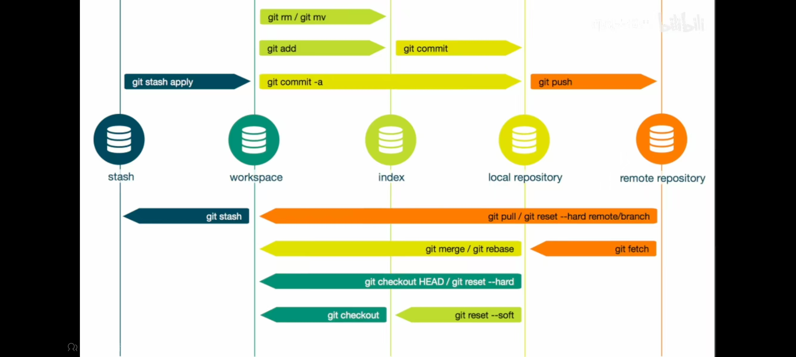

## 五个区



Git 把文件放在五个地方，理解这些位置，后面的命令就好记了。

- **工作区**（working directory / workspace）：磁盘上你正在编辑的文件。新文件在这里是未跟踪状态（untracked），`git add` 之后才进入下一个区。
- **暂存区**（stage / index）：等着被提交的快照。`git add` 把改动放进这里。
- **本地仓库**（local repository）：`git commit` 之后，提交记录存在这里。
- **远端仓库**（remote repository）：GitHub 等平台上的那一份。
- **贮藏区**（stash）：一个临时抽屉。工作做到一半要切分支时，把改动塞进去，回头再取出来。

## 常规设置

```bash
git config --global user.name "Ricardo_MI" # 名字里没有空格时，双引号可以省略
git config --global user.email "ricardoryn1317@gmail.com"
git config --global init.defaultBranch main # 新仓库默认分支叫 main

# 查看配置文件
cat ~/.gitconfig
```

## SSH 免密登录

```bash
ssh-keygen -t rsa -b 4096 -C ricardoryn1317@gmail.com
```

- `-t` 指定加密算法
- `-b` 指定密钥长度
- `-C` 给公钥加一行注释，一般写邮箱

回车后会看到：

```text
Generating public/private rsa key pair.
Enter file in which to save the key (/Users/你的用户名/.ssh/id_rsa):
```

这里可以自己填保存位置，建议直接回车用默认路径。想放到别处就输入完整路径，例如 `~/.ssh/git_ssh_key`。（Windows 的 Git Bash 会把路径显示成 `/c/Users/...`，意思一样。）

接着问要不要给密钥设密码，直接回车表示不设。最后输出：

```text
Your identification has been saved in /Users/你的用户名/.ssh/id_rsa
Your public key has been saved in /Users/你的用户名/.ssh/id_rsa.pub
```

打开 `.pub` 结尾的那个文件，复制里面全部内容。登录 GitHub，进入 `Settings` → `SSH and GPG keys` → `New SSH key`，Title 随便写（例如 `ricardo_github`），把内容粘到 Key 里保存。

```bash
ssh -T git@github.com # 测试连接，看到 "Hi 用户名! You've successfully authenticated" 就成功了
```

如果仓库地址是 `https://` 形式，想改成 SSH 写法，用这条命令：

```bash
git remote set-url origin git@github.com:RicardoRyn/nvim.git
```

> 现在更推荐 `ssh-keygen -t ed25519`，密钥更短，同样安全。已经有 RSA 密钥就不用换。

### 补充：免密登录服务器

```bash
# 已经生成过密钥就不用再执行这一条
ssh-keygen -t rsa -b 4096 -C ricardoryn1317@gmail.com

# 真正有用的命令
ssh-copy-id aaa@xxx.xxx.xxx.xxx
```

`ssh-copy-id` 把本地公钥写到远程机器的 `~/.ssh/authorized_keys`，之后登录就不用输密码。

## GPG 签名

commit 签名用的是 GPG 密钥。Git 用私钥对 commit 的内容（作者、时间、树对象、父 commit 等）算出签名，附在提交上。推送到 GitHub 后，平台用你的公钥**验证**这个签名，确认提交确实来自你，且内容没被改过。

这里要分清两件事：

- 邮箱可以随便填。平台只验证推送的人是谁，不验证历史提交写的是谁。所以 `user.email` 只是一个**身份声明**。
- 签名做的是**身份验证**，防止伪造和篡改。

```bash
gpg --full-generate-key
```

按提示选择：

1. 算法：直接回车，用默认的 RSA and RSA。
2. 长度：输入 4096 并回车，比默认的 3072 位更安全。
3. 有效期：直接回车，选「永不过期」最省事。
4. 确认信息：检查一遍，输入 `y` 回车。
5. 用户 ID：这一步最重要。姓名随便填，邮箱必须和你 GitHub 账号的邮箱**完全一致**（大小写也要一致）。注释可留空。
6. 密码（passphrase）：设置并确认一个密码，务必记住。这一步会弹出输入框。

```bash
gpg --list-secret-keys --keyid-format=long
```

输出类似这样：

```text
gpg: checking the trustdb
gpg: marginals needed: 3  completes needed: 1  trust model: pgp
gpg: depth: 0  valid:   1  signed:   0  trust: 0-, 0q, 0n, 0m, 0f, 1u
/Users/你的用户名/.gnupg/pubring.kbx
------------------------------------
sec   rsa4096/XXXXXXXXXXXXXXXX 2026-05-28 [SC]
      YYYYYYYYYYYYYYYYYYYYYYYYYYYYYYYYYYYYYYYY
uid                 [ultimate] RicardoRyn (T8) <RicardoRyn1317@gmail.com>
ssb   rsa4096/ZZZZZZZZZZZZZZZZ 2026-05-28 [E]
```

- `X`：主密钥 ID，16 位，可公开。它是 `Y` 的后 16 位，用作公钥的简称。
- `Y`：主密钥指纹，40 位，可公开。它是公钥的完整哈希，用来核对密钥真伪。
- `Z`：子密钥 ID，16 位，可公开，用来加密。
- 私钥存在 `~/.gnupg/private-keys-v1.d/` 目录下。

让 Git 使用这个密钥：

```bash
# 1. 指定签名用的密钥，替换成你的密钥 ID
git config --global user.signingkey XXXXXXXXXXXXXXXX
# 2. 每次提交自动签名
git config --global commit.gpgsign true
```

Windows 上如果后面出错，需要明确指定 GPG 程序：

```bash
git config --global gpg.program "C:\Program Files (x86)\GnuPG\bin\gpg.exe"
```

最后把公钥交给代码托管平台：

```bash
gpg --armor --export XXXXXXXXXXXXXXXX # 复制输出内容，粘到 GitHub 的 GPG keys 里
```

编辑 `~/.gnupg/gpg-agent.conf`，减少输入密码的次数：

```text
# 8 小时
default-cache-ttl 28800   # 从最后一次使用算起（空闲超时）
max-cache-ttl 28800       # 从第一次输入算起（绝对超时）
```

重启 gpg-agent 生效：

```bash
gpgconf --kill gpg-agent
gpgconf --launch gpg-agent
```

## 操作

### 常用命令

```bash
git status

git add .                # 把文件加入暂存区
git restore --staged 文件名 # 把文件撤出暂存区，改动留在工作区

git commit # 打开编辑器，写较长的提交信息
git commit -m "提交信息"
git commit -a -m "提交信息" # -a 是 --all：自动把已跟踪文件的改动加入暂存区
git commit --amend      # 修改最近一次的提交信息或内容

git switch 分支名     # 切换本地分支
git switch -c 分支名  # 新建并切换分支
git checkout 远端分支名 # 在本地检出远端分支，会自动建立跟踪关系
```

分支的增删查：

```bash
git branch                   # 列出本地分支
git branch -a                # 连远端分支一起列出
git branch -d 分支名            # 删除已合并的分支
git branch -D 分支名            # 强行删除未合并的分支
git push origin --delete 分支名 # 删除远端分支

git rm --cached 文件名 # 停止追踪文件，但保留磁盘上的文件
```

### 推送到远端

```bash
git remote add origin https://github.com/RicardoRyn/Plot_fig.git
git remote -v

git push                # 第一次推送要输入用户名和 token
git push -u origin main # 设置上游分支，之后直接 git push 即可
git push --tags         # 推送所有 tag
```

### 从远端拉取

```bash
git fetch # 只更新本地仓库，工作区的文件不变
```

确认没有冲突后再合并：

```bash
git diff origin/main # 看清差异
git pull             # 本地和远端的 commit 不同时，会自动 merge 并生成合并提交
git pull --rebase    # 变基方式合并，不会生成合并提交
```

建议顺序是 `fetch` → `diff` → `pull`。

### 比较与查看

```bash
# 两点比较：分支 2 上有、分支 1 上没有的改动
git log 分支1..分支2
git diff 分支1..分支2

# 三点比较：分支 2 上有、但两个分支的共同祖先没有的改动
# GitHub 的对比页面默认用三点比较
git diff 分支1...分支2

# 工作区与各区域的比较
git diff          # 工作区 vs 暂存区
git diff --staged # 暂存区 vs 本地分支
git diff HEAD     # 工作区 vs 本地分支
```

### 贮藏

```bash
git stash    # 保存已跟踪文件的改动；未跟踪文件默认不在内
git stash -u # 连未跟踪文件一起保存
git stash -a # 连被忽略的文件也一起保存

git stash list

git stash apply 'stash@{0}' # 取出来但保留这条 stash
git stash drop 'stash@{0}'  # 手动删除某条 stash
git stash pop               # 取出来并删除这条 stash
```

> PowerShell 里花括号是特殊语法，`stash@{0}` 要用引号包起来。

### 合并与变基

```bash
git merge feature          # 在 main 上执行，把 feature 合并进 main
git merge --no-ff feature  # 非快进合并，会生成 merge commit
git merge --squash feature # 压缩成一次改动，之后还要手动 commit
git merge origin/分支名       # 把远端分支合并到当前分支

git cherry-pick 提交1 提交2 # 在 main 上执行，把指定的提交挑过来，注意顺序

git rebase main # 在 feature 上执行，把 feature 变基到 main 上
```

`merge` 和 `rebase` 的区别值得单独记：`merge` 保留分叉历史，`rebase` 把提交接到目标分支末尾，历史是直线。

### 关于各种撤回

| 类型    | 命令                          | 用在哪                   | 注意                       |
| ------- | ----------------------------- | ------------------------ | -------------------------- |
| discard | `git restore 文件名`          | 工作区的改动还没提交     | 改动直接丢弃，不可恢复     |
| discard | `git restore --staged 文件名` | 已经 add，想撤出暂存区   | 只动暂存区，工作区文件不变 |
| discard | `git restore .`               | 想丢掉所有未提交的改动   | 不可恢复                   |
| reset   | `git reset --soft 提交`       | 撤销提交，改动留在暂存区 | 改写历史                   |
| reset   | `git reset --mixed 提交`      | 撤销提交，改动留在工作区 | 默认模式，改写历史         |
| reset   | `git reset --hard 提交`       | 连改动一起丢弃           | 不可恢复                   |
| revert  | `git revert 提交`             | 已推送的提交想抵消       | 生成新提交，不改写历史     |
| amend   | `git commit --amend`          | 修改最近一次提交         | 已推送时要 force push      |

## 标签

```bash
git tag v1.0.0
git tag v1.0.1 提交 # 给指定的提交打标签
git push --tags

git tag -d v1.0.0                   # 删除本地标签
git push origin --delete tag v1.0.0 # 删除远端标签
```

## 参考视频

- [十分钟学会正确的 GitHub 工作流，和开源作者们使用同一套流程 - 哔哩哔哩](https://b22.tv/vR4P09H)
- [看完这个，你终于能理解 Git 了 | LearnThatStack](https://www.bilibili.com/video/BV1va2ZBzEhx/)

## 理解 `checkout`、`reset`、`revert`

Git 是一个数据库，基本单位是 commit。

一个 commit 就是项目在某一时刻的完整快照。它记录的不是「改了什么」，而是每个文件当时的完整状态。

### commit

每个 commit 有三部分：

1. 指向完整快照的指针
2. 元数据：谁创建的、什么时候、提交信息
3. 指向父 commit 的指针

靠父指针串起来，所有提交构成一张 DAG（directed acyclic graph，有向无环图）。

### branch

branch 不是代码库的独立副本。它只是一个指针，一张写着某个提交哈希值的便利贴。

新建分支时，Git 只是多写一个小文件，说明这个分支指向哪个 commit。

所以分支就是贴在 commit 上的标签。commit 不知道有哪些分支，分支本身也不包含 commit。

在分支上提交新 commit 时，Git 自动把标签挪到新 commit 上。这就是分支的全部概念。

### HEAD

Git 靠 HEAD 知道你在哪。

HEAD 也是一个指针，但通常不直接指向提交，而是指向某个分支。

在 main 上时，HEAD 指向 main 分支，main 指向一个 commit。

### checkout

执行 `git checkout feature` 时，Git 把 HEAD 指向 feature 分支，不指向某个 commit。

执行 `git checkout <commit-id>` 时，HEAD 直接指向那个 commit，进入 detached HEAD 状态。这时你仍然可以提交，但没有分支跟着你走。切走之后，这些提交就成了孤儿提交（orphan commit），最终会被垃圾回收。

小结：`git checkout <commit-id>` 只做两件事，把 HEAD 指向那个 commit，把工作目录更新成该 commit 的快照。commit 本身没变，分支没移动，历史也没变。你可以四处看看、做点试验，然后在下一次 checkout 时丢掉这些实验提交。

### reset

在 main 上执行 `git reset a1b2c3`，意思是把 main 指向这个 commit。

此时 a1b2c3 和原 main 之间的提交都成了孤儿提交。这些提交的内容去哪，取决于用哪个模式。

#### `--soft`

1. 工作区不变。
2. 暂存区不变。
3. 孤儿提交的内容进入暂存区，等着重新提交。

安全。内容都还在，只是原本在提交里的东西回到了暂存区。

#### `--mixed`

这是 `reset` 的默认模式。

1. 工作区不变。
2. 暂存区的内容退回工作区。
3. 孤儿提交的内容进入工作区。

安全。所有内容都还在，只是全部回到了工作区。

#### `--hard`

1. 工作区重置到该提交，未提交的改动无法找回。
2. 暂存区重置，里面的内容无法找回。
3. 孤儿提交的内容丢失，但还能通过 reflog 找回。

危险。除了孤儿提交本身，其他都没了。

### revert

用一个新的提交，抵消某个旧提交的改动，从而达到回滚效果。历史不改写，适合已经推送出去的情况。
