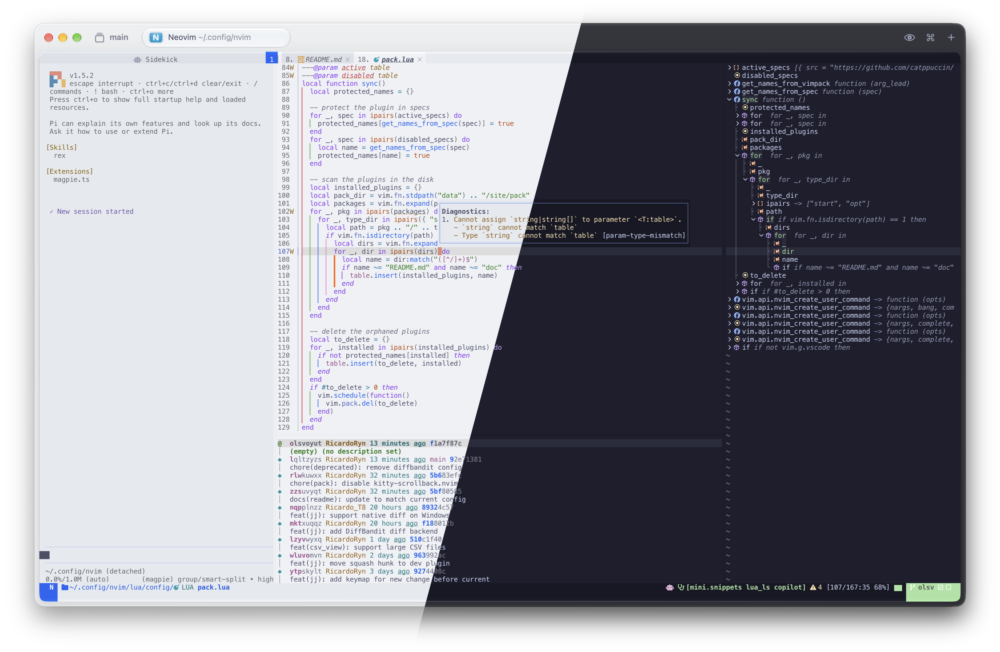

我的 Neovim 配置经历了三次构建：
第一次基于 [LazyVim](https://www.lazyvim.org/)；
第二次改用 [lazy.nvim](https://lazy.folke.io/) 从头搭；
第三次则基于 [vim.pack](https://neovim.io/doc/user/pack/) 重写。

所以现在这套配置依赖 Neovim 0.12+：

- 内置插件管理器 `vim.pack`；
- 内置通知 UI `vim._core.ui2`。

配置仓库：[RicardoRyn/nvim](https://github.com/RicardoRyn/nvim)。



## 功能概览

### 插件管理

插件管理靠 `vim.pack`，插件清单见 `lua/config/pack.lua`。

已安装但当前配置不再声明的插件，会被视为孤儿插件，并在下一次启动 nvim 时被自动删除。

若只是暂时停用某个插件，但仍希望将其保留在磁盘上，可以把它写进 `disabled_specs`。
这些条目不会被加载，但仍受保护而不会被当作孤儿插件删除。

| 命令                     | 快捷键       | 作用                    |
| ------------------------ | ------------ | ----------------------- |
| `:PackStatus`            | `<leader>Ps` | 查看已安装插件状态      |
| `:PackUpdate`            | `<leader>Pu` | 检查插件更新（dry-run） |
| `:PackUpdate!`           | `<leader>PU` | 更新并跳过确认          |
| `:PackDel <plugin_name>` | 无           | 删除指定插件            |

### 启动

开了 `vim.loader`，Lua 模块编译后有缓存，第二次启动快一些。

补全（`mini.completion` 加 `mini.snippets`）是懒加载的，等第一个普通文件 buffer 出现才初始化。
见 `lua/config/completion.lua`。

> 喂，前面可是地狱啊！（指查看 nvim 启动时间）

自定义命令 `:StartupTime` 本身不计时，而是会读出 `nvim --startuptime <log_file>` 写下的日志，报告最后一条 `--- NVIM STARTED ---` 对应的时间。
所以你得先用 `--startuptime` 参数启动 nvim，或者通过 `NVIM_STARTUP_LOG` 把日志路径告诉它。

每次手敲 `nvim --startuptime <log_file>` 太麻烦，可以在 `.bashrc` 里把 `nvim` 包一层，让每次启动都自动带上日志，退出后再把日志清掉：

```bash
function nvim() {
  local dir="${TMPDIR:-/tmp}"
  dir="${dir%/}"
  local log="$dir/nvim-startup-$$.log"
  NVIM_STARTUP_LOG="$log" command nvim --startuptime "$log" "$@"
  local rc=$?
  rm -f "$log"
  return $rc
}
```

> 你完全可以无视启动速度，一辈子都用不到 `:StartupTime` 命令。
> 至少该配置在我日常使用中的启动速度完全可以接受。

### Treesitter

本配置使用 [`nvim-treesitter`](https://github.com/nvim-treesitter/nvim-treesitter)管理 Tree-sitter 语言解析器及其 queries，
为 nvim 提供基于语法树的编辑功能。
安装语言解析器需要使用 [tree-sitter-cli](https://github.com/tree-sitter/tree-sitter/blob/master/crates/cli/README.md) 进行构建。
请确保已安装该命令行工具，并将其加入 PATH。

如果你使用cargo，可以：

```bash
cargo install --locked tree-sitter-cli # build it from source
# or
cargo binstall tree-sitter-cli # with cargo-binstall
```

### LSP

`lsp/` 里预置了六个语言服务器，并通过 `lua/config/lsp.lua` 中的 `vim.lsp.enable()` 启用：

- `lua_ls`
- `pyright`
- `bashls`
- `marksman`
- `rust_analyzer`
- `texlab`

> LSP 服务器配置由 [nvim-lspconfig](https://github.com/neovim/nvim-lspconfig) 提供，语言服务器则通过 [mason.nvim](https://github.com/mason-org/mason.nvim) 安装和管理。
>
> 你可以在 `plugin/mason_nvim.lua` 中修改需要安装的语言服务器列表，移除不需要的服务器，或添加其他服务器。

### 自定义模块

有些需求太小，不值得引入一个过重的插件。
这类功能自己写（向AI许愿），逻辑更简单：

| 模块             | 说明                                                                                          |
| ---------------- | --------------------------------------------------------------------------------------------- |
| `sessions`       | 按工作目录自动保存和恢复会话（见 `plugin/sessions.lua`）                                      |
| `buffer_actions` | buffer 的循环、移动、关闭、固定，供 heirline tabline 使用（见 `lua/utils/buffer_actions`）    |
| `csv_view`       | CSV 渲染、粘性表头，大文件按采样计算列宽（见 `lua/utils/csv_view`）                           |
| `heirline`       | statusline（15 个以上组件）和 tabline（bufferline / tabpages）构件（见 `lua/utils/heirline`） |
| `lazy`           | 首次按下某个快捷键或执行某条命令时，才执行插件 setup（见 `lua/utils/lazy`）                   |
| `mini_nvim`      | `mini.nvim` 部分插件的扩展，主要是 `mini.files`（见 `lua/utils/mini_nvim`）                   |
| `snacks_nvim`    | `snacks.nvim` 的配置与扩展：picker、indent、todos、调试工具（见 `lua/utils/snacks_nvim`）     |
| `icons.lua`      | 图标字形映射（diff、diagnostics、DAP 等）（见 `lua/utils/icons.lua`）                         |
| `jj_log`         | 结合 heirline 展示 `jj log` 的信息（见 `lua/utils/jj_log.lua`）                               |
| `special_mode`   | 识别部分特殊的启动场景（比如 jj、hunk.nvim）的 diff 编辑器（见 `lua/utils/special_mode.lua`） |
| `system`         | 系统识别（Windows / macOS / Linux，以及具体的发行版）（见 `lua/utils/system.lua`）            |

> `lua/utils/deprecated/` 里是旧配置，
> 这个目录下的文件一个都不会被加载，只当备份和参考留着。
> 不喜欢也可以删除这个文件夹。
>
> `mini_nvim` 也有大量对 `mini.pick` 的扩展配置，但是我不用 `mini.pick` 辣，白写这么多。

### 兼容 VSCode

配置支持通过 [VSCode Neovim](https://github.com/vscode-neovim/vscode-neovim) 在 VSCode 里做模态编辑。

> Neovim 对 Jupyter Notebook 的支持不太行，只能用 VSCode。
> 但是没有 nvim 的模态编辑以及 `flash.nvim` 插件，会死。

#### 配置步骤

1. 在 VSCode 插件市场安装 `VSCode Neovim`。

2. VSCode 的 `settings.json` 里增加如下配置：

   ```json
   {
     // vscode-neovim
     "vscode-neovim.neovimClean": false,
     "extensions.experimental.affinity": {
       "asvetliakov.vscode-neovim": 1
     },
     "vscode-neovim.compositeKeys": {
       "jk": {
         "command": "vscode-neovim.escape"
       }
     }
   }
   ```

3. 再配置亿些 VSCode 的快捷键，与 nvim 对齐，减少认知负担，参考我的 [keybindings.json](https://github.com/RicardoRyn/nvim/blob/main/docs/Code/keybindings.json)。
   另有 VSCode 专属的键位在下面的 [VSCode 键位](#vscode-键位) 里。

#### VSCode 里能用的插件

大多数 nvim 插件在 VSCode 中都不会启用，只有下面这些编辑类插件才会照常工作：

- **flash.nvim**：光标快速跳转（**为了这碟醋**）
- **mini.ai**：更强的文本对象
- **mini.bracketed**：用 `[` / `]` 跳到上一个 / 下一个目标
- **mini.jump**：增强 `f` / `t` 跳转，带目标高亮
- **mini.move**：任意方向移动选区或行
- **mini.operators**：排序、替换、乘法、求值
- **mini.pairs**：括号和引号自动补全
- **mini.splitjoin**：代码的拆分与合并
- **mini.statuscolumn**：自定义 statuscolumn（signs、fold、行号）
- **mini.surround**：快速增删改包围符
- **nvim-treesitter-textobjects**：基于 treesitter 的文本对象

## 项目结构

```text
~/.config/nvim/
├── init.lua                  # 入口
├── nvim-pack-lock.json       # 插件版本锁
├── stylua.toml               # Lua 格式化配置
├── .luarc.json               # Lua LSP 配置
├── .github/                  # CI
│
├── lua/
│   ├── config/               # 核心配置
│   │   ├── autocmds.lua      # 自动命令
│   │   ├── completion.lua    # 延迟初始化的 mini.completion + mini.snippets
│   │   ├── keymaps.lua       # 键位
│   │   ├── lsp.lua           # 启用 LSP，并挂 LspAttach 键位
│   │   ├── options.lua       # Neovim 选项
│   │   └── pack.lua          # vim.pack 插件清单
│   │
│   ├── dev/                  # 本地插件，以及从开发目录加载
│   ├── neogen/               # Neogen 注释模板
│   │   └── python/           # Python docstring 模板
│   └── utils/                # 工具模块
│       ├── buffer_actions/   # buffer 管理
│       ├── csv_view/         # CSV 查看（对齐、粘性表头、大文件）
│       ├── deprecated/       # 归档配置（不加载）
│       ├── heirline/         # statusline / tabline 组件
│       ├── lazy/             # 用到键或命令时才做插件 setup
│       ├── mini_nvim/        # mini.files 扩展与 archived 配置的辅助
│       ├── snacks_nvim/      # snacks.nvim 配置
│       ├── icons.lua         # 图标映射
│       ├── jj_log.lua        # jj log 辅助
│       ├── special_mode.lua  # 特殊模式识别（如 jj desc、hunk.nvim 的 jj split）
│       └── system.lua        # 系统识别（Windows / Mac / Linux）
│
├── plugin/                   # 各插件的配置 + 自定义脚本
│   ├── sessions.lua          # 会话管理（自己写的）
│   └── ...                   # 一个插件一个文件
│
├── docs/                     # 截图 + VSCode 键位参考
├── ftplugin/                 # 按文件类型的简单设置
├── after/                    # 按文件类型的设置 & treesitter query 覆盖
├── lsp/                      # LSP server 定义（nvim-lspconfig 的默认值）
└── snippets/                 # 自定义 snippets
```

## 键位

> [!WARNING]
> **以下键位可能过时，最新键位见[配置仓库](https://github.com/RicardoRyn/nvim)。**

Leader 是 `<Space>`，local leader 是 `\`。

### Leader 键位

<details>
<summary> 展开看全部 </summary>

```text
<leader>
├── <Space> -- 找文件
├── a (AI)
│   ├── a - Sidekick 开关
│   ├── d - Sidekick detach
│   ├── f - Sidekick 发送文件
│   ├── p - Sidekick prompt
│   ├── s - Sidekick 选择
│   ├── t - Sidekick 发送当前内容
│   └── v - Sidekick 发送可视选区
├── b (Buffer)
│   ├── a - 关闭全部 buffer
│   ├── b - 选择并关闭 buffer
│   ├── d - 关闭当前 buffer
│   ├── l - 关闭左侧 buffer
│   ├── o - 关闭其他 buffer
│   ├── p - 固定 / 取消固定 buffer
│   ├── r - 关闭右侧 buffer
│   ├── < - buffer 左移
│   └── > - buffer 右移
├── d (调试 / DAP)
│   ├── b - 断点
│   ├── B - 条件断点
│   ├── c - 运行到光标
│   ├── C - 清空断点
│   ├── h - hover
│   ├── i - step into
│   ├── k - step out（同 <leader>dO）
│   ├── l - 启动 OSV server
│   ├── o - step over
│   ├── O - step out
│   ├── r - 重启
│   ├── R - 开关 REPL
│   ├── s - 开始 / 继续
│   ├── t - 结束会话
│   ├── u - 开关调试 UI
│   ├── v - 开关 virtual text
│   └── f (浮窗)
│       ├── e - 表达式
│       ├── f - 调用栈
│       ├── s - 会话
│       ├── S - 作用域
│       └── t - 线程
├── D (开发)
│   ├── m - Snacks metrics
│   ├── r - Snacks 运行 Lua
│   └── s - Snacks size
├── e (文件浏览)
│   ├── e - 文件（mini.files）
│   └── f - 当前目录下的文件
├── f (查找)
│   ├── c - 配置文件
│   ├── g - git 文件
│   ├── m - 智能查找（最近 + 模糊）
│   ├── p - 项目
│   ├── r - 最近文件
│   ├── t - 当前文件的全部 todo
│   └── T - 当前文件的核心 todo
├── g (Git)
│   ├── b - 行 blame
│   ├── p - 预览 hunk
│   ├── P - 预览 hunk（浮窗）
│   ├── r - 重置 hunk
│   ├── R - 重置 buffer
│   ├── s - squash hunk（本地开发插件，仅 Windows）
│   ├── t - 开关行 blame
│   ├── w - 开关 word diff
│   └── h (GitHub)
│       ├── i - 打开的 Issues
│       ├── I - 全部 Issues
│       ├── p - 打开的 PR
│       └── P - 全部 PR
├── j (Jujutsu)
│   ├── a - JJ annotate
│   ├── A - JJ abandon
│   ├── b (bookmark)
│   │   ├── c - 创建
│   │   ├── d - 删除
│   │   └── m - 移动
│   ├── B - JJ browse
│   ├── d - 当前 buffer 的 diff
│   ├── D - JJ describe
│   ├── e - JJ edit
│   ├── f - JJ fetch
│   ├── l - 全部 jj log
│   ├── L - jj log
│   ├── n - JJ new
│   ├── N - JJ new（插在当前版本之前）
│   ├── r - JJ rebase
│   ├── R - JJ redo
│   ├── s - JJ status
│   ├── S - JJ squash
│   ├── U - JJ undo
│   ├── p (推送 / PR)
│   │   ├── l - 列出可用 bookmark 并开 PR
│   │   ├── p - JJ push
│   │   └── r - 用当前（或父）版本的 bookmark 开 PR
│   └── t (tag)
│       ├── d - 删除
│       ├── p - 推送
│       └── s - 设置
├── l (LSP)
│   ├── a - code action
│   ├── d - 诊断（浮窗）
│   ├── f - 格式化 buffer 或选区（conform.nvim）
│   ├── i - implementation
│   ├── m - 开关 split / join（mini.splitjoin）
│   ├── n - 重命名
│   ├── N - 生成 docstring
│   ├── r - references
│   ├── R - 重启 LSP
│   ├── t - type definition
│   ├── v - 虚拟环境（仅 Python）
│   └── x - codelens
├── n (通知)
│   ├── m - messages
│   └── n - 通知历史
├── o - 大纲
├── P (插件)
│   ├── c - 预演清理（列孤儿）
│   ├── C - 清理（删孤儿）
│   ├── s - 状态
│   ├── u - 更新
│   └── U - 更新（不确认）
├── s (搜索)
│   ├── b - buffer
│   ├── c - 命令
│   ├── d - 当前 buffer 的诊断
│   ├── D - 全部诊断
│   ├── h - help
│   ├── H - 高亮组
│   ├── i - 图标
│   ├── I - 入向调用
│   ├── j - jj 改动过的文件
│   ├── J - 跳转列表
│   ├── k - 键位
│   ├── l - LSP 信息
│   ├── L - 位置列表（loclist）
│   ├── m - 标记
│   ├── M - man 手册
│   ├── O - 出向调用
│   ├── p - 拼写
│   ├── P - picker 列表
│   ├── r - 恢复上次搜索
│   ├── s - LSP 符号
│   ├── S - 工作区 LSP 符号
│   ├── t - 全部 todo
│   ├── T - 核心 todo
│   ├── u - undo 树
│   ├── v - 剪贴板历史
│   ├── x - qflist
│   ├── " - 寄存器
│   ├── . - scratch
│   ├── / - 搜索历史
│   └── : - 命令历史
├── t (标签页 / 终端)
│   ├── d - 删除标签页
│   ├── f - 浮窗终端
│   ├── n - 新建标签页
│   ├── r - 重命名标签页
│   ├── s - 拆分标签页
│   ├── t - 底部终端
│   ├── v - 分屏终端
│   └── z - 标签页 zoxide（tcd）
├── u (UI)
│   ├── a - 开关动画
│   ├── b - 开关背景
│   ├── c - 选择配色
│   ├── d - 开关诊断
│   ├── D - 开关 dim
│   ├── h - 开关 inlay hints
│   ├── i - 开关缩进线
│   ├── l - 开关相对行号
│   ├── L - 开关行号
│   ├── m - Markdown 浏览器预览
│   ├── n - 清掉通知
│   ├── r - 重绘 UI
│   ├── s - 开关 screenkey
│   ├── S - 开关 scroll
│   ├── t - 开关 treesitter
│   ├── w - 开关 wrap
│   ├── W - 开关 words
│   ├── z - 开关 zoom
│   └── Z - 开关 zen
├── z - Zoxide
├── . - Scratch
└── / (Grep)
    ├── b - 在 buffer 里 grep
    ├── l - 按行 grep
    ├── w - grep 光标下的词
    └── / - grep
```

</details>

### 其他键位

**移动与导航**

- `jk`：退出插入模式
- `xx`：flash 跳转
- `X`：flash treesitter 搜索
- `xw` / `xr`：跳到光标下的词 / 恢复上次搜索
- `xh` / `xl`：跳到词首 / 词尾
- `xj` / `xk`：跳到下一行 / 上一行
- `r` / `R`（operator-pending）：远端 flash / treesitter 搜索
- `Ctrl+s`（命令行）：开关 flash 搜索
- `;` / `,`：重复上一次文本对象移动
- `Shift+h` / `Shift+l`：上一个 / 下一个 buffer
- `Ctrl+h` / `Ctrl+j` / `Ctrl+k` / `Ctrl+l`：在 Linux 和 Windows 上切换 Neovim 分屏。macOS 上由 Rex 会话接管，rex-navigator.nvim 先切分屏，到边界再切 Rex 的 pane
- `]h` / `gh`：下一个 hunk
- `[h` / `gH`：上一个 hunk
- `]H` / `[H`：最后一个 / 第一个 hunk

**文本对象与编辑**

- `ciq`、`dab`、`yiw`：增强文本对象（mini.ai）
- `saiw"`、`sr'"`、`sd'`：包围符操作（mini.surround）
- `E` / `B`：跳到行尾 / 行首

**搜索替换**

- `<localleader>r`（默认 `\r`，普通模式）：全项目搜索替换（grug-far.nvim）

**按文件类型**

- CSV：自动进入表格视图。大文件按采样计算列宽。`:CsvViewToggle` 开关视图，`Tab` / `Shift+Tab` 在字段之间移动
- Markdown：Markview 渲染行内混合预览，`<leader>um` 打开浏览器预览（live-preview.nvim）

**AI**

- `Tab`（普通模式）：跳到下一处编辑建议，或应用当前建议（sidekick.nvim NES）
- `Ctrl+y` / `Ctrl+w`：接受 Copilot 建议 / 接受一个词
- `Alt+]` / `Alt+[`：下一条 / 上一条 Copilot 建议
- `Esc`：关掉 Copilot 建议

**终端**

- `Ctrl+/`：打开终端

### VSCode 键位

```text
<leader>
├── <Space> / ff（文件）- 快速打开文件
├── a - 开关活动栏
├── aa - 开关辅助栏
├── b (Buffer)
│   ├── d - 关闭 buffer
│   ├── o - 关闭其他 buffer
│   ├── a - 关闭全部 buffer
│   ├── l - 关闭左侧 buffer
│   ├── r - 关闭右侧 buffer
│   ├── < - buffer 左移
│   └── > - buffer 右移
├── e - 开关侧边栏
├── l (LSP)
│   ├── f - 格式化文档（普通模式）/ 格式化选区（可视模式）
│   └── r - 重命名符号
├── o (大纲)
│   ├── o - 聚焦大纲
│   └── v - 开关大纲显示
└── u (UI)
    └── z - 开关 zen 模式
```

**移动与导航**

- `xx`：flash 跳转
- `X`：flash treesitter 搜索
- `xw` / `xr`：跳到光标下的词 / 恢复上次搜索
- `xh` / `xl`：跳到词首 / 词尾
- `xj` / `xk`：跳到下一行 / 上一行
- `Shift+h`：上一个 buffer
- `Shift+l`：下一个 buffer
- `Ctrl+h` / `Ctrl+l`：左右切换窗口（VSCode 的 keybindings 里也接了）
- `Ctrl+o` / `Ctrl+i`：后退 / 前进
- `]d` / `[d`：VSCode 原本映射为下一个 / 上一个诊断；nvim-treesitter-textobjects 设置好之后，改为跳到下一个 / 上一个条件语句开头
- `]D` / `[D`：下一个 / 上一个条件语句结尾（treesitter）
- `za`：开关折叠

**编辑**

- `u` / `Ctrl+r`：撤销 / 重做
- `Ctrl+d` / `Ctrl+u`：光标下移 / 上移 5 行
- `Ctrl+y`：接受行内建议（VSCode 原生）

**文本对象**

- `ciq`、`dab`、`yiw`：增强文本对象
- `saiw"`、`sr'"`、`sd'`：包围符操作

**Jupyter Notebook 单元格**

- `l`：编辑当前单元格
- `c`：Markdown 单元格转代码单元格
- `y`：复制单元格
- `p`：粘贴单元格
- `Ctrl+Backspace`：清空所有单元格输出
- `Alt+Backspace`：清空当前单元格输出
- `Ctrl+j Ctrl+k`：退出单元格编辑模式；视上下文展开或折叠单元格输入
- `Ctrl+Shift+Alt+C`：折叠所有单元格输入
- `Shift+Alt+Backspace`：重启 kernel
- `Alt+h` / `Alt+l`：折叠 / 展开 notebook 单元格

**终端**

- `Ctrl+/`：开关内置终端
- `Ctrl+Shift+=`：开关面板最大化
- `Ctrl+Backtick`：内置终端没聚焦时，打开外部终端

## 试试

通过指定不同的 `NVIM_APPNAME`，可以在不影响现有 Neovim 配置、插件和会话的情况下，运行一套独立的 Neovim 环境：

```bash
jj git clone https://github.com/RicardoRyn/nvim "${XDG_CONFIG_HOME:-$HOME/.config}/nvim-rr"
NVIM_APPNAME=nvim-rr nvim
```

> 国内用户可尝试以下镜像：
>
> - [Gitee](https://gitee.com/RicardoRyn/nvim)、
> - [Codeberg](https://codeberg.org/RicardoRyn/nvim)、
> - [Tangled](https://tangled.org/ricardoryn.tngl.sh/nvim)。

首次启动之后：

1. 打开 `:Mason`，确认 `plugin/mason_nvim.lua` 里列出的语言服务器、格式化和调试适配器正在自动安装；
2. 装完跑一遍 `:checkhealth`，检查依赖和 LSP 是否正常；
3. 然后按自己的习惯改。

> [!IMPORTANT]
> 若首次启动时出现大量错误，可能是 `vim.pack` 在安装插件时遇到网络问题，导致部分插件安装失败。
> 此时，请重启 Neovim。
> 本配置会自动清理 `stdpath("data")/site/pack/core/opt` 目录下因安装失败而遗留的空插件目录，并重新尝试安装这些插件。
>
> 此设置仅在 Neovim 0.12 稳定版本上经过测试，夜间构建版本则不在测试范围内。

## 贡献

欢迎 [issue](https://github.com/RicardoRyn/nvim/issues) 与 [PR](https://github.com/RicardoRyn/nvim/pulls)。:)

---

[MIT LICENSE](https://github.com/RicardoRyn/nvim/blob/main/LICENSE)
